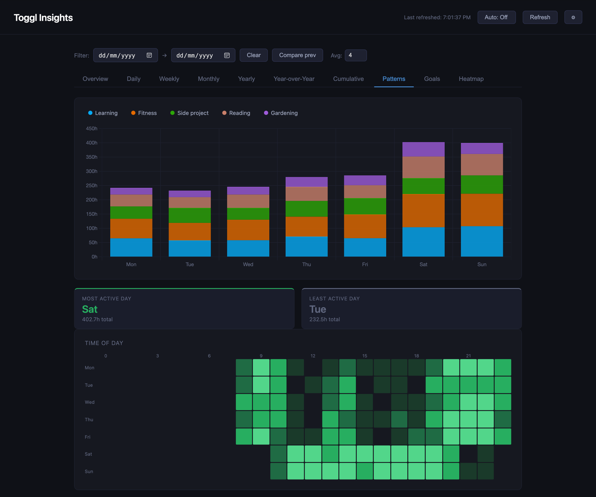

# Toggl Insights

[](https://github.com/mbologna/toggl-insights/actions/workflows/ci.yml)

A personal time-tracking dashboard and alerting system built on top of
[Toggl Track](https://track.toggl.com)'s Reports API. One FastAPI app serves a
single-page dashboard (daily/weekly/monthly/yearly charts, year-over-year
comparison, a GitHub-style activity heatmap, hour-of-day patterns, weekly
targets, and annual goals), backed by a SQLite archive that accumulates time
entries indefinitely — Toggl's own APIs only expose recent history on demand,
so this project keeps its own append-only copy. A separate set of scheduled
entrypoints sends weekly/monthly reports and a lapsed-habit nudge to [Apprise](https://github.com/caronc/apprise).



*Generated, fictional data (`scripts/demo.py`).*

## Architecture

```
                 ┌─────────────────────────────┐
                 │   Toggl Reports API (v3)    │
                 └──────────────┬──────────────┘
                                │
                 ┌──────────────▼──────────────┐
                 │   TogglReportsClient         │  src/toggl.py
                 │   (rate-limit aware, chunks  │
                 │    ranges into ≤366d pages)  │
                 └──────────────┬──────────────┘
                                │
                 ┌──────────────▼──────────────┐
                 │   TogglArchive (SQLite)      │  one row per time entry,
                 │   /data/toggl.db             │  grows forever
                 └──┬───────────────────────┬───┘
                    │                       │
   ┌────────────────▼───────────┐   ┌───────▼────────────────────┐
   │  FastAPI app (src/main.py) │   │  Alert entrypoints          │
   │  - background sync thread  │   │  (src/alerts.py, run via    │
   │    (hourly refresh + a     │   │   python -m src.alerts)     │
   │    one-time historical     │   │  - weekly digest            │
   │    backfill on first boot) │   │  - monthly report           │
   │  - /api/data, /api/heatmap,│   │  - session-gap nudge        │
   │    /api/hours, /health     │   │                             │
   │  - serves the dashboard    │   │                             │
   └─────────────────────────────┘   └──────────────┬──────────────┘
                                                      │
                                              ┌───────▼────────┐
                                              │  Apprise        │
                                              └─────────────────┘
```

The dashboard (`src/main.py`) and the alert entrypoints (`src/alerts.py`) are
independent processes sharing the same SQLite archive (same `toggl-insights-data`
PVC in k8s), but only the dashboard's background thread ever calls the Reports
API — hourly, plus the one-time historical backfill on first boot. The alert
entrypoints (`_get_client_and_archive()`) deliberately just *read* that already-
synced archive instead of re-fetching it themselves; they used to each
independently re-sync the latest 90–120 days on every run, which meant up to 6
processes (5 alert CronJobs + the dashboard) all drawing from the same
workspace's hourly Reports API quota. Reading the shared archive means alerts
are never more than ~1h stale and cost zero extra quota. Toggl's Reports API is
rate-limited per workspace to an hourly quota on the free plan; the dashboard's
sync backs off and retries on a 402 using the `X-Toggl-Quota-Resets-In` header.

Projects are discovered dynamically from Toggl (`GET /me/projects`, cached 24h)
— there's no hardcoded project list to maintain.

## Environment variables

| Variable | Required | Default | Used by | Purpose |
|---|---|---|---|---|
| `TOGGL_API_TOKEN` | yes | — | both | Toggl API token (Profile → API Token) |
| `TOGGL_WORKSPACE_ID` | yes | — | both | Numeric Toggl workspace ID |
| `APPRISE_URL` | yes (alerts only) | — | alerts | Apprise notify endpoint |
| `TOGGL_DB_PATH` | no | `/data/toggl.db` | both | SQLite archive path |
| `TOGGL_HISTORY_START_DATE` | no | `2006-01-01` | dashboard | How far back the one-time backfill reaches |
| `TOGGL_DAILY_TARGET_HOURS` | no | — | dashboard | Daily hours target shown on the Overview tab |
| `TOGGL_WEEKLY_TARGETS` | no | `{}` | both | JSON map `{"project_id": hours}`, weekly per-project targets |
| `TOGGL_YEARLY_GOALS` | no | `{}` | dashboard | JSON map `{"project_id": hours}`, annual goal tracking |
| `TOGGL_IGNORED_DESCRIPTIONS` | no | `[]` | both | JSON list of entry descriptions never to treat as recurring (see below) |
| `TREND_ALERT_THRESHOLD` | no | `0.25` | alerts | Fractional change beyond which digest/report figures get a ↑/↓ marker (changes under 5% aren't shown) |
| `TREND_ALERT_THRESHOLDS` | no | `{}` | alerts | JSON map `{"project_id": threshold}`, overrides the default per project |
| `OVER_TARGET_THRESHOLD` | no | `0.5` | alerts | Fraction over `TOGGL_WEEKLY_TARGETS` that gets a ⚠ in the digest |
| `ALERT_COOLDOWN_DAYS` | no | `5` | alerts | Minimum days between repeats of the lapsed-routine (per activity) and no-projects alerts |
| `ALERT_DRY_RUN` | no | — | alerts | Log alerts instead of sending them (cooldowns still update) |
| `ALERT_TIMEZONE` | no | `UTC` | alerts | Timezone used to bucket entries into local days/weeks/months |
| `APPRISE_CONNECT_TIMEOUT` / `APPRISE_READ_TIMEOUT` / `APPRISE_RETRIES` | no | `15` / `15` / `4` | alerts | Tuned for a cold cross-cluster Tailscale path between infrequent alert runs |

See `.env.template` for a copy-pasteable starting point.

## Local development

```bash
uv sync
cp .env.template .env   # fill in TOGGL_API_TOKEN / TOGGL_WORKSPACE_ID
uv run uvicorn src.main:app --reload
```

Dashboard: http://localhost:8000. The first boot kicks off a one-time
historical backfill in a background thread (see `TOGGL_HISTORY_START_DATE`) —
on the free tier's hourly quota this can take a while; `/health` stays green
throughout (see below) and the dashboard serves whatever's already archived.

To try the dashboard without a Toggl account, `uv run python scripts/demo.py`
serves it on http://localhost:8000 from three years of made-up entries (no
network calls); that's what the screenshot above shows.

Run an alert entrypoint manually — these read whatever's already in
`TOGGL_DB_PATH`, so the dashboard needs to have been running (and synced at
least once) against the same DB file first, or the archive will just be empty:

```bash
uv run python -m src.alerts --digest       # weekly digest (last completed ISO week)
uv run python -m src.alerts --monthly      # monthly report (last completed month)
uv run python -m src.alerts --session-gap  # lapsed-routine nudge
```

Set `ALERT_DRY_RUN=true` to log what would be sent without actually posting to
Apprise (cooldowns still update, so this doesn't give repeated test runs a
clean slate).

### Tests & lint

```bash
uv run pytest
uv run ruff check .
uv run ruff format --check .
pre-commit run --all-files   # ruff, mypy, bandit, hadolint, etc.
```

Dependencies resolve only to releases at least 7 days old (`exclude-newer` in
`pyproject.toml`), and the Docker image installs exactly what `uv.lock` pins.
To take a CVE fix released less than 7 days ago, add a temporary
`exclude-newer-package = { <package> = false }` override under `[tool.uv]`,
run `uv lock --upgrade-package <package>`, and drop the override once the
release is a week old.

## Recurring activities

Besides whole projects, everything also reports on *recurring activities*:
time entry descriptions (across all projects) that repeat week after week,
detected automatically — no list to maintain. A description is recurring when
it shows up in at least half the ISO weeks of a window:

- **last 8 weeks** — the current routine. The lapsed-routine nudge only
  watches these, so a habit you've really dropped stops nudging after about a
  month.
- **last 26 weeks** — reports (digest, monthly report, dashboard) also include
  these, so a routine that recently lapsed keeps showing up as declining.

One-off entries (a documentary, a meeting) never qualify. Exclude anything you don't
want reported or nudged with `TOGGL_IGNORED_DESCRIPTIONS='["Chores"]'`.

`/api/sessions` returns count and avg/median/min/max length for the last 4 and
12 weeks and all time, plus a per-ISO-week series for the last 26 weeks, for
each one — shown in the "Recurring" card on the dashboard's Patterns tab.

`/api/sessions/typical?description=yoga&weeks=4` answers "how long does this
usually take?" for one description, for scripts and phone automations that
need a single number. `description` is a case-insensitive substring (so emoji
can be left out). Same-day entries are summed into one visit, so a timer
restarted by mistake counts once. Today is excluded, because it is usually
still in progress. `minutes` is the median visit over the last `weeks` (1–52,
default 4). The median is used because one short or forgotten-timer day barely
moves it. The response also carries the visit count and the mean, min and max.
The endpoint returns 404 when nothing matches in the window, and 409 with the
candidate list when the substring matches more than one description.

The archive stores each entry's description (added as a column in an
in-place migration). Rows archived before that have a `NULL` description,
which makes the dashboard re-run the historical backfill once on its next
boot to fill them in.

## Notifications

Two periodic reports plus one nudge. Changes under 5% are left out; ↑/↓ marks
a change beyond `TREND_ALERT_THRESHOLD` (or the per-project override).

**Weekly digest** (`--digest`, Monday morning) — the last completed ISO week:

```
Week 1–7 Jun
• Fitness: 6.0 h
• Reading: 4.5 h  +12%
• Gardening: 2.0 h  new
Total: 12.5 h  +18% ↑

Recurring:
• Yoga: 3× · avg 1h 15m (usually 2×/wk · 1h 00m)
• Spanish: none (usually 1×/wk)

% vs average of the previous 4 weeks
```

Projects with a `TOGGL_WEEKLY_TARGETS` entry get `· target 5.0 h` with ✓ when
met, or ⚠ when over by more than `OVER_TARGET_THRESHOLD`.

**Monthly report** (`--monthly`, on the 1st) — the last completed month, with
a 6-month sparkline per project and per recurring activity (its weekly rate):

```
June 2026
• Fitness: 10.0 h  +100% ↑  ▅▅▅▅▅█
Total: 18.0 h  +40% ↑  ▃▄▄▅▅█

Recurring:
• Yoga: 4× (0.9/wk)  ▄▅▄███ · avg 1h 15m
• Spanish: 4× (0.9/wk)  ▅▅▅▅▅▅ · avg 30m

% vs average of the previous 3 months · bars = last 6 months
```

**Lapsed routines** (`--session-gap`, daily) — a current routine that's gone
about twice its usual interval between active days without happening (never
less than 3 days; several entries on one day count once):

```
Yoga: 7 days since last time (Mon 22 Jun), usually every 3 days
```

Repeats at most every `ALERT_COOLDOWN_DAYS` per activity while the gap lasts.
If nothing at all has been tracked since the lapses began, it sends a single
"is the dashboard sync stuck?" line instead.

Any of these raising "Toggl returned no active projects" means the token,
workspace ID or Toggl itself is broken.

## `/health`

Returns `503` if the SQLite archive isn't reachable, or if the background sync
thread's last successful run is older than 3 hours — the latter catches a
sync thread silently stuck in an exception loop, which would otherwise just
serve increasingly stale data forever. Never flags staleness during the
one-time historical backfill (which can legitimately take hours).

## Deployment

GitHub Actions builds the image and publishes it to
`ghcr.io/mbologna/toggl-insights` (linux/amd64 and linux/arm64). It runs well
as a Deployment for the dashboard plus one CronJob per alert entrypoint.
